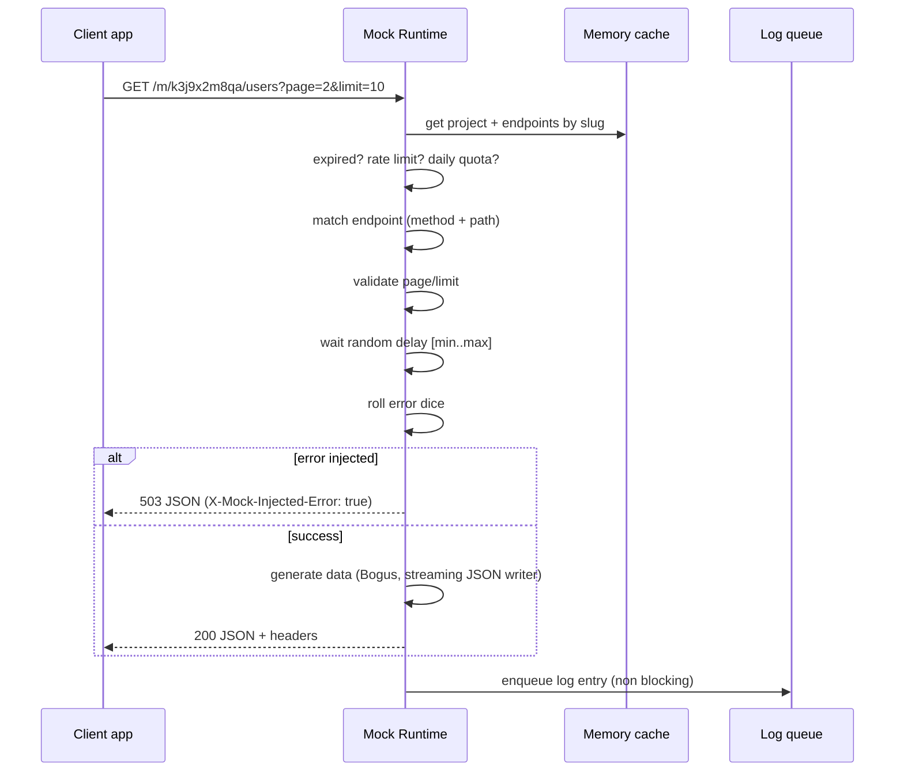

# MockAPI: Technical Specification (Phase 1 + Phase 2)

Backend: **ASP.NET Core + PostgreSQL**. Frontend: **Next.js**.
Source idea: `mock-api-idea.md` ("Mock API generator from a JSON sample").

> Goal of this document: the backend dev and the frontend dev can each build their half **independently**, using only this file and the OpenAPI document the backend will publish. Every HTTP method, status code, header, JSON shape and limit is defined here.
> `MockAPI` is a placeholder product name and `example.com` a placeholder domain.

---

## 0. Status of decisions (read this first)

### 0.1 Confirmed by you

| # | Decision | Value |
|---|---|---|
| D1 | Scope | Phase 1 + Phase 2 of the idea file |
| D2 | Users / auth | **No accounts.** A project is identified by a public `slug` and managed with a secret `editToken` |
| D3 | Database | **PostgreSQL** from day one |
| D4 | Backend | ASP.NET Core Web API |
| D5 | Frontend | Next.js (App Router, TypeScript) |

### 0.2 Defaults I chose that you must confirm or change

I did not want to silently decide these. Each one is a **proposal**; change the value and the rest of the document still holds. Items marked **[CONFIRM]** appear in the text too.

| # | Question | Default used in this document |
|---|---|---|
| Q1 | Public URL layout of the mock | `https://api.example.com/m/{slug}/{path}`; UI at `https://example.com`. The idea file used `mockapi.app/{slug}/{path}`; I added the `/m/` prefix so the mock runtime never collides with management routes |
| Q2 | .NET version | .NET 10 (LTS). Use .NET 9 if 10 is not available to you |
| Q3 | Sample object vs list | A pasted **object** produces an **object**. The UI has a "Return as list" switch (`wrapInList`) that makes the endpoint return an array of that object. Your idea's JS example (`users = await res.json(); renderUsers(users)`) implies a list, so this switch matters |
| Q4 | POST / PUT / DELETE behavior | **Stateless.** They return generated data (nothing is stored between calls). Default success codes: POST 201, PUT 200, DELETE 204 (no body) |
| Q5 | Methods supported | `GET`, `POST`, `PUT`, `DELETE` only (as in the idea). `PATCH`, `HEAD` are not supported (`HEAD` returns 405) |
| Q6 | Path parameters (`/users/{id}`) | Supported for **matching** only. The value is not injected into the response |
| Q7 | Project lifetime | 7 days from creation, **no extension** in v1. After expiry the mock returns `410 Gone` for 3 more days, then the project is purged (404) |
| Q8 | Free limits (numbers) | See section 11.1. All numbers are configuration values, nothing is hard-coded |
| Q9 | Request logs content | Method, path, query, status, delay, latency, injected-error flag, content-type, user-agent, and the **request body truncated to 4 KB**. No IP address is stored. Last 1000 entries per project |
| Q10 | Real-time logs | **Polling** every 2 s (`after` cursor). SSE can be added later |
| Q11 | Error injection | Equal probability for each selected status code. Random decisions are never seeded |
| Q12 | Generated-data locale | English (`en`) only in v1 |
| Q13 | Hosting | **Single instance** (container) + managed PostgreSQL. Rate limiting is in-memory. If you plan to scale to more than one instance, tell me: Redis must be added |
| Q14 | Bot protection on project creation | None in v1 besides IP rate limit. (Optional: Cloudflare Turnstile) |
| Q15 | UI language | English UI, LTR. (Your idea file is Arabic; tell me if the UI must be Arabic/RTL or bilingual) |
| Q16 | cURL / OpenAPI import, screenshot, accounts, teams, billing, custom domains | **Out of scope** (Phase 3) |

---

## 1. Product summary and scope

A free web tool. The developer pastes a JSON sample, the system infers a **schema** (field types and meaning), and returns a **live URL**. Every call to that URL returns **new realistic data** with the same shape, after a configurable **delay**, and with configurable **random errors**.

### 1.1 In scope

**Phase 1 (MVP)**
- Paste JSON, analyze it, review and edit the inferred schema, create a project with one endpoint.
- Realistic data generation by field name, value pattern and type. Nested objects and arrays supported.
- Delay (fixed or random range).
- Random errors by percentage with selectable status codes.
- CORS enabled for every origin on the mock URL.
- No sign-up.

**Phase 2**
- Several endpoints per project (different paths and methods).
- List size (fixed or random range, including 0 and 1) and pagination (`?page=2&limit=10`).
- Fixed seed for repeatable data.
- Request log viewer.
- Usage limits and automatic expiry.

### 1.2 Out of scope
Accounts and teams, permanent links, payments, OpenAPI/Swagger import, cURL import, screenshot-to-schema AI, custom domains, request-body validation against a schema, stateful CRUD (stored records), SSE/WebSocket logs.

---

## 2. System architecture

### 2.1 Components

```
 Browser (developer)                               Browser / app under development
        |                                                      |
        | HTTPS (UI pages)                                     | HTTPS (mock calls, any origin, CORS *)
        v                                                      v
 +------------------+   HTTPS + CORS (allowed origin)   +-------------------------------+
 |  Next.js         | --------------------------------> |  ASP.NET Core app             |
 |  example.com     |   /api/v1/*  (Management API)     |  api.example.com              |
 +------------------+                                   |                               |
                                                        |  [Management API]  /api/v1/*  |
                                                        |  [Mock Runtime]    /m/{slug}/*|
                                                        |  [Background jobs]            |
                                                        |   - log writer (batch)        |
                                                        |   - usage counter flush       |
                                                        |   - expiry + log cleanup      |
                                                        +---------------+---------------+
                                                                        |
                                                                        v
                                                                  PostgreSQL
```

- **One ASP.NET deployable** with three parts: Management API, Mock Runtime, background services. Keep them in separate folders/namespaces so they can be split later.
- **Next.js calls the Management API directly from the browser** (CORS). There is no BFF/proxy layer. Auth is a bearer token in a header, not a cookie, so there is no CSRF surface.
- **Mock Runtime hot path does not touch the database.** Project + endpoints + compiled schema are cached in memory. Only request logs and usage counters are written, asynchronously and in batches.

### 2.2 Request lifecycle of a mock call (summary)



The full step-by-step rules are in section 9.

---

## 3. Global conventions

| Topic | Rule |
|---|---|
| Base paths | Management API: `/api/v1`. Mock Runtime: `/m/{slug}`. Health: `/health/live`, `/health/ready` |
| Versioning | Management API versioned in path (`v1`). The mock URL is never versioned |
| Content type | Requests and responses are `application/json; charset=utf-8`. Errors of the Management API are `application/problem+json` (RFC 9457) |
| JSON naming | `camelCase` for all property names in the Management API |
| Enums | Strings (e.g. `"GET"`), never numbers |
| IDs | `endpoint.id` is a GUID string. `project` is addressed by `slug` (10 chars, `[a-z0-9]`) |
| Dates | ISO 8601 UTC with `Z`, e.g. `2026-10-20T12:00:00Z` |
| DB naming | `snake_case` tables and columns (use `EFCore.NamingConventions` -> `UseSnakeCaseNamingConvention()`) |
| Auth header | `Authorization: Bearer <editToken>` on every project-scoped Management API call except creation |
| Correlation | Every response (both surfaces) has header `X-Request-Id` (GUID). Problem responses also contain `traceId` |
| OpenAPI | Backend publishes `/openapi/v1.json` (built in `Microsoft.AspNetCore.OpenApi`). Frontend generates its TypeScript types from it |
| Null handling | Optional request properties may be omitted or `null`; the server treats both the same |
| Unknown properties | Rejected with `400` (strict binding) so typos in settings are not silently ignored |

### 3.1 Standard error body (Management API)

```json
{
  "type": "https://example.com/errors/validation_failed",
  "title": "One or more validation errors occurred.",
  "status": 400,
  "code": "validation_failed",
  "detail": "See 'errors' for details.",
  "traceId": "00-7f9c...-01",
  "errors": {
    "endpoints[0].settings.delay.maxMs": ["Must be greater than or equal to minMs."],
    "endpoints[0].path": ["Must start with '/'."]
  }
}
```

- `code` is the stable machine-readable value the frontend switches on (catalog in Appendix B).
- `errors` is present only for `validation_failed` and `sample_invalid`. Keys use dotted/indexed paths into the request body.
- `Retry-After` (seconds) is added to every `429`.

---

## 4. Database (PostgreSQL 16+)

Four tables. Sample data pasted by the user is **never stored**, only the inferred schema (see 5.4 about the one exception: enum values).

### 4.1 DDL

```sql
CREATE TABLE projects (
    id               uuid         PRIMARY KEY DEFAULT gen_random_uuid(),
    slug             varchar(16)  NOT NULL UNIQUE,
    name             varchar(60)  NULL,
    edit_token_hash  bytea        NOT NULL,              -- SHA-256 of the token (32 bytes)
    created_at       timestamptz  NOT NULL DEFAULT now(),
    expires_at       timestamptz  NOT NULL,
    last_request_at  timestamptz  NULL
);
CREATE INDEX ix_projects_expires_at ON projects (expires_at);

CREATE TABLE endpoints (
    id               uuid         PRIMARY KEY DEFAULT gen_random_uuid(),
    project_id       uuid         NOT NULL REFERENCES projects(id) ON DELETE CASCADE,
    method           varchar(6)   NOT NULL CHECK (method IN ('GET','POST','PUT','DELETE')),
    path             varchar(200) NOT NULL,              -- as typed, normalized (see 10.4)
    path_normalized  varchar(200) NOT NULL,              -- lower-case, used for uniqueness/matching
    schema_version   smallint     NOT NULL DEFAULT 1,
    schema_json      jsonb        NOT NULL,              -- section 5
    settings_json    jsonb        NOT NULL,              -- section 8
    created_at       timestamptz  NOT NULL DEFAULT now(),
    updated_at       timestamptz  NOT NULL DEFAULT now(),
    CONSTRAINT uq_endpoints_route UNIQUE (project_id, method, path_normalized)
);

CREATE TABLE request_logs (
    id                   bigint       GENERATED ALWAYS AS IDENTITY PRIMARY KEY,
    project_id           uuid         NOT NULL REFERENCES projects(id) ON DELETE CASCADE,
    endpoint_id          uuid         NULL REFERENCES endpoints(id) ON DELETE SET NULL,
    request_id           uuid         NOT NULL,
    method               varchar(8)   NOT NULL,
    path                 varchar(300) NOT NULL,           -- actual requested path (after /m/{slug})
    query                varchar(500) NULL,               -- truncated
    status               smallint     NOT NULL,
    injected_error       boolean      NOT NULL DEFAULT false,
    delay_ms             integer      NOT NULL DEFAULT 0,
    latency_ms           integer      NOT NULL,           -- total server time
    request_content_type varchar(100) NULL,
    request_body         text         NULL,               -- truncated to 4096 bytes
    user_agent           varchar(200) NULL,
    created_at           timestamptz  NOT NULL DEFAULT now()
);
CREATE INDEX ix_request_logs_project_id_id ON request_logs (project_id, id DESC);

CREATE TABLE project_usage_daily (
    project_id     uuid     NOT NULL REFERENCES projects(id) ON DELETE CASCADE,
    day            date     NOT NULL,                     -- UTC day
    request_count  integer  NOT NULL DEFAULT 0,
    PRIMARY KEY (project_id, day)
);
```

### 4.2 Notes for the backend dev

- **`jsonb` does not preserve key order.** That is why the schema format (section 5) stores object fields as an **array**, not as a JSON object. Do not change that.
- Map `schema_json` / `settings_json` with EF Core JSON columns (`OwnsOne(...).ToJson()`) or a `string` + value converter. Your choice; the JSON shape is what matters.
- `edit_token_hash`: the token is 32 random bytes (high entropy), so plain SHA-256 is enough (no bcrypt). Compare with `CryptographicOperations.FixedTimeEquals`.
- `slug`: 10 characters from `[a-z0-9]` generated with `RandomNumberGenerator` (not `Random`). Retry on unique-constraint violation (max 5 attempts).
- Cascade deletes are done by PostgreSQL. Deleting a project removes endpoints, logs and usage rows.
- **Retention of logs**: keep the newest 1000 rows per project (cleanup job, section 12.6).
- No IP address is stored anywhere in the database.

---

## 5. Schema format (the core data structure)

The schema describes the **rules** for generating a response. It is produced by the inference engine (section 6), can be edited by the user in the UI, and is stored in `endpoints.schema_json`.

### 5.1 TypeScript definition (frontend and backend must match exactly)

```ts
type Schema = { version: 1; root: SchemaNode };

type SchemaNode = ObjectNode | ArrayNode | LeafNode;

type ObjectNode = {
  type: "object";
  fields: Field[];                 // ORDER MATTERS: output keeps this order
};

type Field = {
  name: string;                    // JSON property name
  node: SchemaNode;
  nullProbability?: number;        // 0..1, default 0  (field is sometimes null)
  omitProbability?: number;        // 0..1, default 0  (field is sometimes absent)
};

type ArrayNode = {
  type: "array";
  item: SchemaNode;
  length?: { min: number; max: number };   // used for NESTED arrays only (see 5.3)
};

type LeafNode = {
  type: "string" | "integer" | "number" | "boolean" | "null";
  generator: { name: string; params?: Record<string, unknown> };   // catalog in section 7
};
```

### 5.2 Example: schema inferred from the idea file's sample

Sample:
```json
{ "id": 1, "name": "Ahmed Benali", "email": "ahmed@example.com", "age": 28, "created_at": "2026-01-15T10:30:00Z" }
```

Inferred schema:
```json
{
  "version": 1,
  "root": {
    "type": "object",
    "fields": [
      { "name": "id",         "node": { "type": "integer", "generator": { "name": "autoId", "params": { "start": 1 } } } },
      { "name": "name",       "node": { "type": "string",  "generator": { "name": "fullName" } } },
      { "name": "email",      "node": { "type": "string",  "generator": { "name": "email" } } },
      { "name": "age",        "node": { "type": "integer", "generator": { "name": "randomInt", "params": { "min": 18, "max": 80 } } } },
      { "name": "created_at", "node": { "type": "string",  "generator": { "name": "dateTime", "params": { "kind": "past", "rangeDays": 365, "format": "iso-datetime" } } } }
    ]
  }
}
```

### 5.3 Where lengths come from

| Array | Length is controlled by |
|---|---|
| Root array (or the array at `settings.list.path`) | `settings.list.size`, or pagination when enabled (section 8). `length` on that node is ignored |
| Any other (nested) array | The node's own `length` `{min,max}`. Random integer in `[min,max]` per array per response |

### 5.4 Privacy rule
The inference endpoint receives the sample, analyzes it **in memory** and returns only the schema. The sample is never persisted or logged. The one exception: fields that become `enum` generators keep their distinct sample values (e.g. `["active","blocked"]`), because the schema cannot work without them. The UI must tell the user: *"Do not paste real or sensitive data."*

---

## 6. Inference engine (sample JSON to schema)

Input: any valid JSON value. Output: `Schema` + a list of `warnings`.

### 6.1 Limits on the sample

| Limit | Value |
|---|---|
| Max request body size (`/infer`, `/projects`) | 256 KB (whole body) |
| Max sample size | 100 KB serialized |
| Max nesting depth | 10 |
| Max fields in one object | 100 |
| Max total nodes in the schema | 2000 |

Violations return `422 sample_too_complex` (or `413` if the body itself exceeds 256 KB).

### 6.2 Algorithm

1. **Parse** with `System.Text.Json` (`JsonElement`). Integer vs decimal is decided from the raw number text (`1` integer, `1.0` or `1e3` number).
2. **Walk recursively**, building `ObjectNode` / `ArrayNode` / `LeafNode`.
3. **Arrays**: merge all items into a single `item` node.
   - Objects: union of fields by name, first-seen order kept.
   - A field missing in k of n items gets `omitProbability = k/n`. A field that is `null` in k of n present items gets `nullProbability = k/n`.
   - Conflicting types in one position: choose the most frequent non-null type; `integer` + `number` becomes `number`. Add warning `mixed_types`.
   - Empty array: `item` becomes a `null` leaf and warning `empty_array` is added (user should edit).
   - `length` for nested arrays: `{ min: 1, max: max(3, n) }` where n is the sample length.
4. **Leaf generator selection**, in this order (first match wins):
   - **A. Value pattern** (strings only, high confidence): UUID, ISO date-time, `yyyy-MM-dd`, email, URL, hex color, IPv4.
   - **B. Name rules** (table 6.3).
   - **C. Type fallback** (table 6.4).
5. **Enums from arrays**: when a root/nested array has at least 2 items and a string field has between 2 and 10 distinct values, it becomes `enum` with those values.
6. **`wrapInList`** option: if true and the root is not an array, wrap the root: `root = { type: "array", item: <old root> }`.
7. **Suggestions** (returned in the response, not stored):
   - `pagination.listPath`: JSON Pointer of the only array field of a root object (e.g. `/data`), if exactly one exists.
   - `pagination.bindings`: auto-detected envelope fields (names `page`, `limit`/`per_page`/`pageSize`, `total`/`totalItems`/`count`, `totalPages`, `hasNext`, `hasPrev`).

### 6.3 Name rules (type = string unless noted)

Key normalization: split on non-alphanumerics and camelCase boundaries, lower-case. `createdAt` -> `[created, at]`, `user_email` -> `[user, email]`. "Parent hint" = tokens of the parent field name or of the endpoint path.

| # | Condition on key tokens | Generator |
|---|---|---|
| 1 | last token `email` or `mail` | `email` |
| 2 | `first`+`name`, or `firstname`, `givenname` | `firstName` |
| 3 | `last`+`name`, or `lastname`, `surname`, `familyname` | `lastName` |
| 4 | `username`, `login`, `handle`, `nickname` | `username` |
| 5 | `company`, `organization`, `employer`, `brand`; or `name` with parent hint `company/org/employer` | `company` |
| 6 | `name` with parent hint `product/item/goods`, or `sku`-like context | `productName` |
| 7 | `name`, `fullname`, `displayname` | `fullName` |
| 8 | `phone`, `mobile`, `tel`, `telephone`, `fax` | `phone` |
| 9 | `city`, `town` | `city` |
| 10 | `country` (with token `code`: `countryCode`) | `country` / `countryCode` |
| 11 | `province`; or `state` with parent hint `address/location/billing/shipping` | `state` |
| 12 | `street`, `address`, `address1`, `address2` | `streetAddress` |
| 13 | `zip`, `postal`, `postcode` | `zipCode` |
| 14 | `currency` | `currencyCode` |
| 15 | `avatar` | `avatarUrl` |
| 16 | `photo`, `picture`, `image`, `img`, `thumbnail`, `logo`, `icon` | `imageUrl` |
| 17 | `url`, `uri`, `link`, `website`, `homepage`, `href` | `url` |
| 18 | `color`, `colour` | `hexColor` |
| 19 | `ip`, `ipaddress` | `ipv4` |
| 20 | `job`, `position`, `jobtitle` | `jobTitle` |
| 21 | `title`, `headline`, `subject` | `sentence` (3 to 8 words) |
| 22 | `description`, `summary`, `bio`, `about`, `content`, `body`, `comment`, `message`, `note`, `notes`, `text` | `paragraph` |
| 23 | `status`, `state` (no address hint), `type`, `kind`, `role`, `category`, `level`, `priority`, `gender` | `enum` with the sample value(s) |
| 24 | birth words: `birth`, `birthday`, `dob` | `date` with `kind: "past"`, `rangeDays: 29200`, `minDaysAgo: 6570` |
| 25 | future words: `expires`, `expiry`, `due`, `deadline`, `until`, `scheduled`, `next` + date/time/at | `dateTime` `kind: "future"` |
| 26 | date words: last token `at`, `on`, `date`, `time`, `timestamp`, or token `created`, `updated`, `deleted` | `dateTime` / `date` (follows the sample's format), `kind: "past"`, `rangeDays: 365` |
| 27 | **integer** key exactly `id` | `autoId` |
| 28 | **integer/number** `age` | `randomInt` 18..80 |
| 29 | **integer** `year` | `randomInt` 1990..(current year) |
| 30 | **integer/number** `rating`, `score`, `stars` | integer: `randomInt` 1..5; number: `randomDecimal` 1..5, precision 1 |
| 31 | **integer/number** `price`, `amount`, `cost`, `total`, `subtotal`, `fee`, `salary`, `balance`, `budget`, `revenue` | `price` min 1, max `max(100, value*2)` |
| 32 | **integer** last token `count`, `quantity`, `qty`, `stock`, `likes`, `views`, `followers` | `randomInt` 0..`max(100, value*2)` |
| 33 | **integer/number** `percent`, `percentage` | `randomInt` / `randomDecimal` 0..100 |
| 34 | **number** `lat`, `latitude` / `lng`, `lon`, `longitude` | `randomDecimal` -90..90 / -180..180, precision 6 |
| 35 | **integer** between 1e9 and 4e9 and a date-word token | `unixTimestamp` |

String values that are numeric-looking (e.g. `"19.99"` under `price`) keep `type: "string"` and use the same generator; the generator formats its output according to the node type.

### 6.4 Type fallbacks (rule C)

| Value | Generator |
|---|---|
| integer `v` | `randomInt` min `min(0, v*2)`, max `max(10, v*2)` |
| number `v` | `randomDecimal` same range, precision = decimals in the sample (max 6) |
| boolean | `randomBool` (`trueProbability` 0.5) |
| string | `words`, count = words in the sample +/-1, clamped to 1..6 |
| null | `nullValue` (warning `null_type_unknown`) |

### 6.5 Warnings returned by inference

```json
{ "code": "mixed_types", "path": "/items/0/price", "message": "Values have different types; 'number' was chosen." }
```
Codes: `mixed_types`, `empty_array`, `null_type_unknown`, `enum_from_sample`, `key_order_unspecified` (not used in v1). Warnings never block creation.

---

## 7. Generator catalog and data generation

### 7.1 Catalog

All generators produce a value of the **node type** they are attached to. Params are validated server-side; unknown generator names or params return `400 validation_failed`.

| Generator | Node types | Params (defaults) | Output example |
|---|---|---|---|
| `autoId` | integer | `start` (1) | In a list: `start + index` (pagination-aware: `(page-1)*limit + index + start`). Outside a list: random int 1..100000 |
| `randomInt` | integer | `min`, `max` (required) | `42` |
| `randomDecimal` | number | `min`, `max`, `precision` (2) | `3.7` |
| `price` | number, string | `min` (1), `max` (1000) | `19.99` or `"19.99"` |
| `unixTimestamp` | integer | `kind` (`past`), `rangeDays` (365) | `1767225600` |
| `randomBool` | boolean | `trueProbability` (0.5) | `true` |
| `nullValue` | null | none | `null` |
| `uuid` | string | none | `"3f2b..."` |
| `email` | string | none | `"jane.doe@example.org"` |
| `fullName` / `firstName` / `lastName` | string | none | `"Jane Doe"` |
| `username` | string | none | `"jane_doe42"` |
| `phone` | string | none | `"+1-555-0143"` |
| `city` / `country` / `countryCode` / `state` | string | none | `"Lyon"` |
| `streetAddress` / `zipCode` | string | none | `"12 Oak Street"` |
| `company` / `productName` / `jobTitle` | string | none | `"Acme Corp"` |
| `currencyCode` | string | none | `"EUR"` |
| `url` / `imageUrl` / `avatarUrl` | string | none | `"https://picsum.photos/..."` (see 7.4) |
| `hexColor` / `ipv4` | string | none | `"#a1b2c3"` |
| `words` | string | `min` (1), `max` (3) | `"quiet river"` |
| `sentence` | string | `minWords` (3), `maxWords` (8) | `"The system updates quickly."` |
| `paragraph` | string | `sentences` (3) | text |
| `dateTime` | string | `kind` (`past`/`future`/`recent`, default `past`), `rangeDays` (365), `format` (`iso-datetime`/`iso-datetime-ms`) | `"2026-03-02T08:15:00Z"` |
| `date` | string | `kind`, `rangeDays`, `minDaysAgo` (0) | `"2026-03-02"` |
| `enum` | string, integer | `values` (required, 1 to 50) | one of the values (equal probability) |
| `constant` | any leaf | `value` (required) | always that value |

Date output is always UTC, seconds precision, `Z` suffix (`iso-datetime-ms` adds `.fff`).

### 7.2 Libraries (backend)
- `Bogus` (the .NET Faker) for names, emails, addresses, lorem, etc.
- `System.IO.Hashing` (`XxHash32`) for stable seed derivation.

### 7.3 Determinism (when `settings.seed` is not null)

- Same URL + same query + same seed gives **byte-identical** output.
- Per list item `i` (global index, so page 2 continues page 1): `itemSeed = XxHash32(seed, endpointId, i)`; create `new Faker("en") { Random = new Randomizer(itemSeed) }` for that item.
- For non-list responses use `i = 0`.
- Never use `string.GetHashCode()` (it is randomized per process).
- Never use Bogus's static `Randomizer.Seed` (global, not thread-safe).
- Dates are generated relative to a **fixed reference instant** (the project's `created_at`) when seeded, otherwise relative to `UtcNow`. Do not depend on Bogus's system clock.
- `omitProbability`, `nullProbability` and `enum` choices also use the seeded randomizer.
- **Delay and error injection are never seeded.**
- Without a seed: `Random.Shared` and a fresh Faker per request.

### 7.4 Images
`imageUrl` / `avatarUrl` return `https://picsum.photos/seed/{random}/200/200` and `https://i.pravatar.cc/150?u={random}` style URLs (external hosts; the server does not fetch them). **[CONFIRM]** if you prefer a different image host or self-hosted placeholders.

### 7.5 Output writing
Generate straight into `Utf8JsonWriter` on the response body (no big object graph). Enforce a hard cap of **100,000 generated values** per response at runtime; the same estimate is checked at configuration time (section 8.3).

---

## 8. Endpoint settings

Stored in `endpoints.settings_json`. All properties optional on input; defaults are applied and the **full object** is returned.

### 8.1 Shape

```json
{
  "successStatus": 200,
  "delay": { "minMs": 300, "maxMs": 1500 },
  "errors": { "ratePercent": 15, "statusCodes": [500, 503, 429] },
  "list": { "path": null, "size": { "min": 10, "max": 10 } },
  "pagination": {
    "enabled": false,
    "totalItems": 100,
    "defaultLimit": 10,
    "maxLimit": 100,
    "bindings": { "page": null, "limit": null, "total": null, "totalPages": null, "hasNext": null, "hasPrev": null }
  },
  "seed": null
}
```

### 8.2 Fields and validation

| Field | Type | Default | Rule |
|---|---|---|---|
| `successStatus` | int | GET 200, POST 201, PUT 200, DELETE 204 | One of `200, 201, 202, 204`. With `204` no body is generated |
| `delay.minMs`, `delay.maxMs` | int | `0`, `0` | `0..10000`, `minMs <= maxMs`. Equal values = fixed delay. **[CONFIRM]** max 10 s |
| `errors.ratePercent` | number | `0` | `0..100`, at most 1 decimal |
| `errors.statusCodes` | int[] | `[500]` | 1 to 10 unique values, each `400..599`. Required (non-empty) when `ratePercent > 0` |
| `list.path` | string or null | `null` | JSON Pointer (RFC 6901) to the array treated as "the list". `null` = the root, which must then be an array. Must point to an `array` node |
| `list.size.min`, `list.size.max` | int | `10`, `10` | `0..1000`, `min <= max`. Ignored when pagination is enabled |
| `pagination.enabled` | bool | `false` | Requires the list to exist: root is an array, or `list.path` is set |
| `pagination.totalItems` | int | `100` | `0..10000` |
| `pagination.defaultLimit` | int | `10` | `1..maxLimit` |
| `pagination.maxLimit` | int | `100` | `1..100` |
| `pagination.bindings.*` | string or null | `null` | JSON Pointer to a leaf in the root object whose value will be replaced by the real pagination value. Pointers must resolve to a leaf of a compatible type (integer for page/limit/total/totalPages, boolean for hasNext/hasPrev) |
| `seed` | int or null | `null` | Int32 |

### 8.3 Cross-checks done on save (`422` on failure)

| Check | Error `code` |
|---|---|
| Worst-case generated values (max list size or `maxLimit`, times nested `length.max`, times leaves) must be `<= 100000` | `response_too_large` |
| `pagination.enabled` with no usable list | `validation_failed` (error key `settings.pagination.enabled`) |
| `list.path` / binding pointers that do not resolve | `validation_failed` |

### 8.4 Pagination behavior

Query parameters are fixed: `page` (default 1) and `limit` (default `defaultLimit`).

- `page` must be an integer `>= 1`; `limit` an integer `>= 1`. Otherwise `400 invalid_pagination`.
- `limit` greater than `maxLimit` is **clamped** to `maxLimit` (not an error).
- `start = (page-1)*limit`, `count = min(limit, max(0, totalItems - start))`. A page beyond the end returns `200` with an **empty list**.
- `totalPages = ceil(totalItems / limit)` (0 if `totalItems = 0`).
- Where metadata goes:
  - Always as **headers**: `X-Total-Count`, `X-Page`, `X-Limit`, `X-Total-Pages`, and `Link` (`first`, `prev`, `next`, `last` as absolute URLs).
  - Additionally **inside the body** for every `bindings` entry that is set (the bound field's generator is replaced by the real value).
- Other query parameters are ignored.

---

## 9. Mock Runtime (the public mock URL)

Route: `/m/{slug}/{**path}` (and `/m/{slug}` = path `/`). Methods handled: `GET, POST, PUT, DELETE, OPTIONS`. Any other method (including `HEAD`, `PATCH`) returns `405`.

Full URL shown to users: `{mockBaseUrl}/m/{slug}{endpoint.path}`, e.g. `https://api.example.com/m/k3j9x2m8qa/users`.

### 9.1 Processing steps (exact order)

| Step | What happens | Failure result |
|---|---|---|
| 0 | `OPTIONS` (CORS preflight): answer `204` immediately. No delay, no errors, not logged, not counted | n/a |
| 1 | Find project by `slug` in cache (fallback DB) | `404 project_not_found` |
| 2 | `now > expires_at` | `410 project_expired` |
| 3 | Rate limit per slug and per IP (11.2) | `429 rate_limited` (`Retry-After`) |
| 4 | Daily quota of the project (11.1) | `429 daily_quota_exceeded` (`Retry-After` = seconds until 00:00 UTC) |
| 5 | Request body larger than 64 KB | `413 payload_too_large` |
| 6 | Match endpoint by method + path (9.2) | `404 endpoint_not_found`, or `405 method_not_allowed` with `Allow` header when the path exists for other methods |
| 7 | Validate `page` / `limit` when pagination is enabled | `400 invalid_pagination` |
| 8 | **Delay**: wait a random integer in `[minMs, maxMs]` (`Task.Delay` with `RequestAborted`) | n/a |
| 9 | **Error roll**: `Random.Shared.NextDouble()*100 < ratePercent`; if true pick one status code of `statusCodes` (equal probability) and respond (9.3) | injected error |
| 10 | **Generate** and write the body (`successStatus`; no body for `204`) | `500 generation_failed` (real bug; logged as error) |
| 11 | Enqueue log entry (non blocking) and increment usage counter | n/a |

Steps 1 to 5 are not logged in `request_logs` (to prevent log flooding). Steps 6 to 10 are logged, including `404`, `405`, `400` and injected errors.

### 9.2 Path matching

- Compare the request path (percent-decoded) with endpoint paths segment by segment, case-insensitive. A trailing slash is ignored.
- Template segments `{name}` match exactly one non-empty segment.
- If several endpoints match, a **static segment wins over a template**, compared left to right.
- The query string is ignored for matching.

### 9.3 Responses

All runtime responses (success and error):

| Header | Value |
|---|---|
| `Content-Type` | `application/json; charset=utf-8` (not sent for `204`) |
| `Cache-Control` | `no-store` |
| `X-Request-Id` | GUID, same value stored in `request_logs.request_id` |
| `X-Mock-Delay-Ms` | Delay actually applied (0 when step 8 was not reached) |
| `X-Mock-Injected-Error` | `true` only for errors from step 9, otherwise `false` |
| `Access-Control-Allow-Origin` | `*` |
| `Access-Control-Expose-Headers` | `X-Request-Id, X-Mock-Delay-Ms, X-Mock-Injected-Error, X-Total-Count, X-Page, X-Limit, X-Total-Pages, Link, Retry-After, Allow` |

Preflight answer (`OPTIONS`): `Access-Control-Allow-Methods: GET, POST, PUT, DELETE, OPTIONS`, `Access-Control-Allow-Headers: *`, `Access-Control-Max-Age: 86400`. No credentials (`Allow-Credentials` is never sent, because `*` is used).

**Success body**: the generated JSON, shaped by the schema.

**Error body** (both injected and system errors, same shape):

```json
{
  "error": {
    "status": 503,
    "code": "injected_error",
    "title": "Service Unavailable",
    "message": "Simulated error injected by MockAPI.",
    "injected": true,
    "requestId": "b2f1c2a0-5a4f-4c0a-9a43-3f5a8a7a1e11"
  }
}
```

- Injected errors: `code = "injected_error"`, `injected = true`. Add `Retry-After: 3` when the status is `429` or `503`.
- System errors use the codes from Appendix B and `injected = false`.
- The client app can always tell a **simulated** `404` from a **real** one: `injected` flag and `X-Mock-Injected-Error`.

### 9.4 Runtime status code summary

| Status | When |
|---|---|
| `200` / `201` / `202` | Success (`successStatus`) |
| `204` | Success without body (`successStatus = 204`, and preflight) |
| `400` | `invalid_pagination`; or injected 400 |
| `404` | `project_not_found`, `endpoint_not_found`; or injected 404 |
| `405` | `method_not_allowed` (+ `Allow` header), or unsupported method |
| `410` | `project_expired` |
| `413` | `payload_too_large` |
| `429` | `rate_limited`, `daily_quota_exceeded`; or injected 429 |
| `500` | `generation_failed` (bug); or injected 500 |
| `4xx/5xx` selected by user | Injected (`statusCodes`, any `400..599`) |

---

## 10. Management API (`/api/v1`)

### 10.1 Summary

| # | Method | Path | Auth | Success | Purpose |
|---|---|---|---|---|---|
| 1 | GET | `/meta` | none | 200 | Limits, supported values, generator catalog |
| 2 | POST | `/infer` | none | 200 | Sample JSON to schema (nothing stored) |
| 3 | POST | `/preview` | none | 200 | Generate sample output from a schema (nothing stored) |
| 4 | POST | `/projects` | none | 201 | Create project (+ endpoints), returns `editToken` once |
| 5 | GET | `/projects/{slug}` | token | 200 | Project with endpoints and usage |
| 6 | PATCH | `/projects/{slug}` | token | 200 | Rename project |
| 7 | DELETE | `/projects/{slug}` | token | 204 | Delete project and everything under it |
| 8 | POST | `/projects/{slug}/endpoints` | token | 201 | Add endpoint |
| 9 | GET | `/projects/{slug}/endpoints/{id}` | token | 200 | Get one endpoint |
| 10 | PUT | `/projects/{slug}/endpoints/{id}` | token | 200 | Replace endpoint (method, path, schema, settings) |
| 11 | PUT | `/projects/{slug}/endpoints/{id}/schema` | token | 200 | Replace schema only |
| 12 | PUT | `/projects/{slug}/endpoints/{id}/settings` | token | 200 | Replace settings only |
| 13 | DELETE | `/projects/{slug}/endpoints/{id}` | token | 204 | Delete endpoint |
| 14 | GET | `/projects/{slug}/logs` | token | 200 | List request logs |
| 15 | DELETE | `/projects/{slug}/logs` | token | 204 | Clear logs |
| 16 | GET | `/health/live`, `/health/ready` | none | 200 | Liveness / readiness (outside `/api/v1`). Ready returns `503` if the DB is down |

### 10.2 Common errors for all token endpoints

| Status | `code` | When |
|---|---|---|
| 401 | `missing_token` | No/invalid `Authorization: Bearer` header. Response has `WWW-Authenticate: Bearer` |
| 403 | `invalid_token` | Token does not match this project |
| 404 | `project_not_found` | Slug does not exist (or was purged) |
| 410 | `project_expired` | Project is past `expiresAt` (read-only access is **not** allowed; the UI should offer "create a new one") |
| 429 | `rate_limited` | Management rate limit (11.2). `Retry-After` set |
| 500 | `internal_error` | Unexpected. Body has `traceId` |

Check order: slug exists (404) -> token present (401) -> token valid (403) -> not expired (410).

Common errors for every endpoint with a body: `400 validation_failed` (malformed JSON, wrong types, unknown properties, rule violations), `413 payload_too_large` (body > 256 KB), `415 unsupported_media_type` (not `application/json`).

### 10.3 Endpoint details

#### 1. `GET /api/v1/meta`
Response `200`:
```json
{
  "mockBaseUrl": "https://api.example.com/m",
  "projectLifetimeDays": 7,
  "methods": ["GET", "POST", "PUT", "DELETE"],
  "successStatuses": [200, 201, 202, 204],
  "errorStatusRange": { "min": 400, "max": 599 },
  "limits": {
    "maxEndpointsPerProject": 10,
    "maxSampleBytes": 102400,
    "maxRequestBodyBytes": 262144,
    "maxPathLength": 200,
    "maxDelayMs": 10000,
    "maxListSize": 1000,
    "maxPaginationTotalItems": 10000,
    "maxPaginationLimit": 100,
    "maxErrorStatusCodes": 10,
    "dailyRequestsPerProject": 5000,
    "maxLogEntriesPerProject": 1000
  },
  "generators": [
    { "name": "randomInt", "nodeTypes": ["integer"],
      "params": [ { "name": "min", "type": "integer", "required": true },
                  { "name": "max", "type": "integer", "required": true } ] }
  ]
}
```
The frontend builds every dropdown and validation from this response. **Nothing is hard-coded in the frontend.** Cache it for the session.

#### 2. `POST /api/v1/infer`
Request:
```json
{ "sample": { "id": 1, "name": "Ahmed Benali" }, "options": { "wrapInList": false } }
```
`sample` is any JSON value (object, array, even a scalar is rejected, see below). Response `200`:
```json
{
  "schema": { "version": 1, "root": { "type": "object", "fields": [ ... ] } },
  "warnings": [ { "code": "mixed_types", "path": "/0/price", "message": "..." } ],
  "suggestions": {
    "list": { "path": "/data" },
    "pagination": { "bindings": { "page": "/meta/page", "limit": "/meta/limit", "total": "/meta/total" } }
  }
}
```
Errors: `400 validation_failed` (missing `sample`), `422 sample_invalid` (root is a scalar or `null`; message explains), `422 sample_too_complex`, `413`, `429`.

#### 3. `POST /api/v1/preview`
Generates output exactly as the runtime would, **without** delay, errors, logging or storage.
```json
{
  "schema": { "version": 1, "root": { ... } },
  "settings": { "list": { "size": { "min": 3, "max": 3 } }, "seed": 7 },
  "page": 1,
  "limit": 10
}
```
`settings` optional (defaults apply). `page`/`limit` only used when `settings.pagination.enabled`. Response `200`:
```json
{
  "data": [ { "id": 1, "name": "..." } ],
  "pagination": { "page": 1, "limit": 10, "totalItems": 100, "totalPages": 10 }
}
```
`pagination` is `null` when pagination is disabled. Errors: `400`, `422 response_too_large`, `413`, `429`.

#### 4. `POST /api/v1/projects`
Request:
```json
{
  "name": "Users demo",
  "endpoints": [
    {
      "method": "GET",
      "path": "/users",
      "sample": { "id": 1, "name": "Ahmed Benali" },
      "options": { "wrapInList": true },
      "settings": { "delay": { "minMs": 300, "maxMs": 1500 }, "errors": { "ratePercent": 15, "statusCodes": [500, 503, 429] } }
    }
  ]
}
```
Rules:
- `name`: optional, 1 to 60 characters.
- `endpoints`: 1 to `maxEndpointsPerProject` items.
- For each endpoint provide **exactly one** of `sample` (server infers the schema, `options` allowed) or `schema` (already inferred/edited). Both or none: `400`.
- `settings` optional.
- Duplicate `(method, normalized path)` inside the request: `409 duplicate_endpoint`.

Response `201 Created`, header `Location: /api/v1/projects/k3j9x2m8qa`:
```json
{
  "slug": "k3j9x2m8qa",
  "editToken": "et_Qm3v...43chars...",
  "name": "Users demo",
  "createdAt": "2026-10-20T12:00:00Z",
  "expiresAt": "2026-10-27T12:00:00Z",
  "baseUrl": "https://api.example.com/m/k3j9x2m8qa",
  "endpoints": [ { "...": "Endpoint object (10.5)" } ]
}
```
**`editToken` is returned only here, and only its hash is stored. It cannot be recovered.** The UI must make this very clear (section 13.5).
Errors: `400`, `409 duplicate_endpoint`, `413`, `415`, `422` (`sample_invalid`, `sample_too_complex`, `response_too_large`, `endpoint_limit_reached`), `429 rate_limited` (IP creation limit).

#### 5. `GET /api/v1/projects/{slug}`
Response `200`:
```json
{
  "slug": "k3j9x2m8qa",
  "name": "Users demo",
  "createdAt": "...", "expiresAt": "...",
  "baseUrl": "https://api.example.com/m/k3j9x2m8qa",
  "usage": { "requestsToday": 120, "dailyLimit": 5000 },
  "endpoints": [ { "...": "Endpoint object" } ]
}
```
Errors: common (10.2).

#### 6. `PATCH /api/v1/projects/{slug}`
Request `{ "name": "New name" }` (`null` clears it). Response `200`: project object (same as 5). Errors: common + `400`.

#### 7. `DELETE /api/v1/projects/{slug}`
Response `204`, no body. Idempotency: a second call returns `404`.

#### 8. `POST /api/v1/projects/{slug}/endpoints`
Request: one endpoint item, same shape as in endpoint 4 (`method`, `path`, `sample` xor `schema`, `options`, `settings`). Response `201`, `Location: /api/v1/projects/{slug}/endpoints/{id}`, body = Endpoint object.
Errors: common + `400`, `409 duplicate_endpoint` (same method + normalized path exists), `422 endpoint_limit_reached`, `422` (inference / size errors).

#### 9. `GET /api/v1/projects/{slug}/endpoints/{id}`
Response `200`: Endpoint object. Errors: common + `404 endpoint_not_found`.

#### 10. `PUT /api/v1/projects/{slug}/endpoints/{id}`
Full replace. Request:
```json
{ "method": "GET", "path": "/users", "schema": { "version": 1, "root": { } }, "settings": { } }
```
`schema` and `settings` are required here (full replace; the frontend sends what it has). Response `200`: Endpoint object. Errors: common + `400`, `404 endpoint_not_found`, `409 duplicate_endpoint`, `422 response_too_large`.

#### 11. `PUT /api/v1/projects/{slug}/endpoints/{id}/schema`
Request: a `Schema` object. Server re-validates the **existing settings** against the new schema (pointers, list path, size estimate); failing cross-checks return `422` with the offending settings path, and **nothing is saved**. Response `200`: Endpoint object.

#### 12. `PUT /api/v1/projects/{slug}/endpoints/{id}/settings`
Request: an `EndpointSettings` object (section 8). Response `200`: Endpoint object. Errors: `400`, `422`.

#### 13. `DELETE /api/v1/projects/{slug}/endpoints/{id}`
Response `204`. A project may have zero endpoints. Errors: common + `404 endpoint_not_found`.

#### 14. `GET /api/v1/projects/{slug}/logs`
Query parameters:

| Param | Type | Default | Meaning |
|---|---|---|---|
| `limit` | int `1..100` | 50 | Page size |
| `before` | long | none | Return entries with `id < before` (scroll to older) |
| `after` | long | none | Return entries with `id > after` (polling for new). Cannot be combined with `before` (`400`) |
| `endpointId` | guid | none | Filter by endpoint |
| `status` | int | none | Filter by exact status |
| `injected` | bool | none | Filter by injected errors |

Response `200` (always newest first):
```json
{
  "items": [
    {
      "id": 1300,
      "requestId": "b2f1c2a0-5a4f-4c0a-9a43-3f5a8a7a1e11",
      "endpointId": "7d1b...",
      "method": "GET",
      "path": "/users",
      "query": "page=2&limit=10",
      "status": 503,
      "injectedError": true,
      "delayMs": 842,
      "latencyMs": 846,
      "requestContentType": null,
      "requestBody": null,
      "userAgent": "Mozilla/5.0 ...",
      "createdAt": "2026-10-20T12:03:11Z"
    }
  ],
  "nextCursor": 1251,
  "latestId": 1300
}
```
`nextCursor` is the `id` to pass as `before` for older entries, or `null` if there are none. `latestId` is the newest id in the project (use it as the first `after` value when polling). Polling: call with `after=<last seen id>` every 2 s; stop when the tab is hidden.

#### 15. `DELETE /api/v1/projects/{slug}/logs`
Response `204`.

### 10.4 Validation rules

**Path** (`endpoint.path`):
- Starts with `/`, max 200 chars, no query string or fragment, no `//`, no `.` or `..` segments.
- A trailing slash is removed (except for `/`).
- Each segment matches `[A-Za-z0-9._~-]+` **or** is a template `{name}` where `name` matches `[A-Za-z_][A-Za-z0-9_]*`. Parameter names must be unique inside the path.
- `path_normalized`: static segments lower-cased, every template becomes `{}`. So `/Users/{id}` and `/users/{userId}` are the same route (`409`).

**Method**: one of `GET, POST, PUT, DELETE` (case-insensitive on input, stored upper-case).

**Schema**: `version` must be `1`; node types per section 5; field names unique inside an object and 1 to 100 chars; probabilities `0..1`; generator exists and fits the node type; params valid (catalog in `/meta`); total nodes `<= 2000`; depth `<= 10`.

### 10.5 Endpoint object (returned by all endpoint operations)

```json
{
  "id": "7d1b5c3e-2a74-4a9d-8d5f-0c1a9b6e5f10",
  "method": "GET",
  "path": "/users",
  "url": "https://api.example.com/m/k3j9x2m8qa/users",
  "schema": { "version": 1, "root": { } },
  "settings": { },
  "createdAt": "2026-10-20T12:00:00Z",
  "updatedAt": "2026-10-20T12:00:00Z"
}
```
For template paths, `url` keeps the placeholder (`.../users/{id}`); the UI lets the user fill it in when testing.

### 10.6 CORS for the Management API
Allowed origins come from config (`Cors:ManagementOrigins`, e.g. `https://example.com`, `http://localhost:3000`). Allowed methods `GET, POST, PUT, PATCH, DELETE, OPTIONS`; allowed headers `Authorization, Content-Type`; exposed headers `Retry-After, X-Request-Id, Location`. No credentials.

---

## 11. Limits, abuse protection and security

### 11.1 Limits (all in configuration, values are **[CONFIRM]** defaults)

| Limit | Default | Enforced where | Error |
|---|---|---|---|
| Endpoints per project | 10 | Create / add endpoint | `422 endpoint_limit_reached` |
| Project lifetime | 7 days (+3 days `410` grace) | Runtime + cleanup job | `410 project_expired` |
| Requests per project per UTC day | 5000 | Runtime step 4 | `429 daily_quota_exceeded` |
| Request body on Management API | 256 KB | Kestrel / endpoint limit | `413` |
| Request body on mock calls | 64 KB | Kestrel / endpoint limit | `413` |
| Sample size | 100 KB | Inference | `422 sample_too_complex` |
| Max delay | 10000 ms | Validation | `400` |
| Max list size / pagination total | 1000 / 10000 | Validation | `400` |
| Max generated values per response | 100000 | Save + runtime | `422 response_too_large` |
| Log entries kept per project | 1000 | Cleanup job | n/a |

### 11.2 Rate limiting (ASP.NET `Microsoft.AspNetCore.RateLimiting`, in-memory)

| Policy | Partition key | Default | Applies to |
|---|---|---|---|
| `create-project` | client IP | 10 per hour | `POST /projects` |
| `infer-preview` | client IP | 30 per minute | `POST /infer`, `POST /preview` |
| `mgmt-write` | client IP | 60 per minute | all other `POST/PUT/PATCH/DELETE` |
| `mgmt-read` | client IP | 120 per minute | all management `GET` |
| `runtime-slug` | slug | 120 per minute (token bucket allows short bursts) | mock calls |
| `runtime-ip` | client IP | 600 per minute | mock calls |

- Rejections: `429`, `Retry-After` header, correct body for the surface (ProblemDetails or the runtime error JSON).
- **Client IP**: the app sits behind a reverse proxy, so configure `ForwardedHeaders` (`X-Forwarded-For`, `X-Forwarded-Proto`) with **known proxies/networks only**. Otherwise anybody can fake the IP and bypass limits.
- In-memory limiters are per instance. If you run more than one instance, move to a shared store (Redis) **[CONFIRM Q13]**.

### 11.3 Security checklist

- HTTPS only, HSTS enabled in production.
- Security headers on the Management API: `X-Content-Type-Options: nosniff`, `Referrer-Policy: no-referrer`.
- Edit token: 32 random bytes, prefix `et_`, base64url; stored as SHA-256; fixed-time comparison; **never logged** (configure Serilog to drop the `Authorization` header).
- The server never makes outbound requests based on user input (no SSRF surface). Generated image URLs are strings only.
- Strict JSON: `MaxDepth = 32` in `JsonSerializerOptions`, unknown properties rejected, body size limits set before parsing.
- Request bodies of mock calls are stored in logs (truncated). The UI warns users not to send real data to a mock.
- `Content-Type` of mock responses is JSON and `X-Content-Type-Options: nosniff` is set, so generated strings cannot be sniffed as HTML.
- No user-controlled data is ever used in SQL strings (EF Core parameters only).
- Dependency updates enabled (Dependabot or Renovate) for NuGet and npm.
