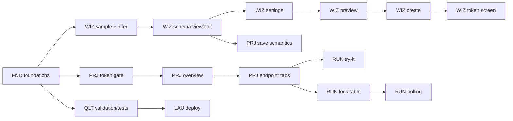

# FakeEnd — Frontend Task Breakdown

> Derived from `fakeend-technical-spec.md` (Phase 1 + Phase 2).
> Stack: **Next.js (App Router) + TypeScript**, browser-to-API calls, no BFF.
> This file is the frontend build plan: scope, architecture, tasks, acceptance criteria, and sequencing.

---

## 0. How to use this document

- Every task has an ID (`FND-03`, `WIZ-06`, …), a priority, a size, dependencies, and testable acceptance criteria.
- **P0** = required for the hackathon demo / Phase 1 happy path.
- **P1** = required to call Phase 2 complete (multi-endpoint, pagination, seed, logs).
- **P2** = polish, only if time remains.
- Sizes: **S** ≈ 1–2 h · **M** ≈ 3–5 h · **L** ≈ 6–10 h · **XL** = split it.
- Check a box only when its acceptance criteria pass against the **real backend** (or the MSW mock built from the OpenAPI document).
- Sections 1–4 are context. Sections 5–10 are the actual work.
- **Per-task files:** [`tasks/`](./legacy-plan/README.md) contains one Markdown file per task with frontmatter, scope, acceptance criteria, notes and tests.

---

## 1. Product scope from the frontend's point of view

A developer pastes a JSON sample → the app infers a schema → they review/edit it → configure delay, random errors, list size, pagination and seed → create a project → get a live FakeEnd URL and a one-time `editToken` → test the URL and watch request logs.

**In scope (frontend):**

| Area | What the UI must do |
|---|---|
| Create | Paste sample, infer, review/edit schema, configure settings, preview, create project |
| Manage | Open a project with slug + token, rename, delete, add/edit/delete endpoints |
| Endpoint editor | Edit schema tree, edit settings, preview, save (full replace or partial) |
| Runtime testing | Call the real FakeEnd URL from the browser, show status/headers/body/latency |
| Observability | Request log table with polling (2 s), filters, pagination, detail view, clear |
| Limits | Everything driven by `GET /api/v1/meta`; never hard-code limits or generator lists |
| Lifetime | Show expiry countdown, 410 expired state, daily usage quota |

**Explicitly out of scope:** accounts, teams, billing, custom domains, cURL/OpenAPI import, screenshot-to-schema, stateful CRUD, SSE logs, Arabic/RTL, dark/light theming beyond one chosen theme.

### 1.1 Assumptions (confirm before build; defaults chosen so work can start)

| # | Question | Assumption used here |
|---|---|---|
| A1 | UI language | English, LTR only |
| A2 | Auth model | No accounts. Project access = `slug` + `editToken` stored client-side; token is sent as `Authorization: Bearer <editToken>` |
| A3 | Token persistence | `localStorage` per slug, optional "remember on this device". Never put the token in a query string or analytics |
| A4 | Project re-entry | "Open project" screen accepts slug + token; recent projects list keeps slug/name/expiry but shows a lock icon when the token is missing |
| A5 | Hosting | Frontend on Vercel; `NEXT_PUBLIC_API_BASE_URL` points at the ASP.NET app; management CORS already allows the frontend origin |
| A6 | UI kit | Tailwind CSS + shadcn/ui + lucide icons; no custom design system |
| A7 | Code editor | CodeMirror 6 (`@uiw/react-codemirror`) for JSON; lazy-loaded |
| A8 | Server state | TanStack Query; forms with React Hook Form + Zod |
| A9 | Dates | Render in local time, label UTC where the API is UTC (`expiresAt`, logs) |
| A10 | Branding | Placeholder "FakeEnd", no logo required for demo |

### 1.2 Spec gaps to confirm with the backend dev

These are referenced by the spec but not included in the file we have. Defaults below keep the frontend unblocked; replace when the backend publishes them.

| Gap | Where referenced | Default to build against |
|---|---|---|
| Error code catalog | "Appendix B" | Use the codes enumerated inside the spec (see §9.2) |
| Detailed UI flows / copy | "section 13.5" | Copy drafted in this document |
| Background jobs / cleanup | "section 12.6" | No UI impact; expiry is read from `expiresAt` |
| Pagination binding pointer format | §8.2, §10.3 | JSON Pointer strings; provide a leaf picker instead of free text |
| Exact `generators[]` catalog shape | §10.3 `/meta` | Render generically from `params[]` (`name`, `type`, `required`) |
| Generator param bounds (e.g. enum max 50) | §7.1 | Enforce only what the backend rejects; show server error inline |
| OpenAPI publication | §3 | Build types with `openapi-typescript`; MSW fallback until it exists |

---

## 2. Frontend architecture

### 2.1 Rendering and data flow

```
Browser
  ├─ Landing / marketing pages ......... static/SSR (no token needed)
  ├─ Builder wizard .................... client component tree, draft in sessionStorage
  ├─ Project workspace ................. client-rendered (token lives in localStorage)
  │     ├─ TanStack Query → Management API (Bearer)
  │     └─ Logs polling (2 s, after cursor, pauses when tab hidden)
  └─ Try-it ............................ direct fetch to FakeEnd runtime URL (CORS *)
```

- **No BFF.** The browser calls `NEXT_PUBLIC_API_BASE_URL` directly. All management requests carry `Authorization: Bearer <editToken>` except `POST /projects` and `GET /meta` / `POST /infer` / `POST /preview`.
- **Token-gated pages must not SSR project data.** Render a client shell with a skeleton, then read the token; this avoids hydration mismatches and accidental token leakage.
- **Meta is the single source of truth** for limits, methods, success statuses, error range and generators. Load once per session, cache in memory + `sessionStorage`.
- **Wizard draft** (sample, inferred schema, settings, endpoint drafts) lives in a Zustand store mirrored to `sessionStorage` so a refresh does not lose work. Clear on successful create.
- **Log filters and cursors** live in the URL (`?endpointId=&status=&injected=&after=`) so views are shareable/back-button friendly.
- **Errors** are normalized once in the API client into `{ status, code, title, detail, errors?, traceId, retryAfter? }`, then rendered by shared components. No ad-hoc `res.ok` checks in components.

### 2.2 Route map

| Route | Purpose | Auth |
|---|---|---|
| `/` | Landing: value prop, paste CTA, how it works, privacy notice | public |
| `/new` | Builder wizard (sample → schema → settings → preview → create) | public |
| `/projects` | Recent projects on this device (from localStorage), restore by slug+token | public shell |
| `/p/[slug]` | Project overview: endpoints, usage, expiry, base URL | token |
| `/p/[slug]/endpoints/[id]` | Endpoint workspace: Schema / Settings / Try it / Logs tabs | token |
| `/p/[slug]/logs` | Full-page log viewer (also embedded as a tab) | token |
| `/p/[slug]/settings` | Rename project, danger zone (delete project, clear logs) | token |
| `/expired` | Help page for `410 project_expired` | public |
| `/help` | Quickstart, cURL examples, error-code reference | public |
| `not-found.tsx`, `error.tsx`, `global-error.tsx` | Recovery states | public |

### 2.3 Folder structure (proposed)

```
src/
  app/
    layout.tsx
    page.tsx                      # landing
    new/page.tsx                  # wizard
    projects/page.tsx             # recent projects
    p/[slug]/layout.tsx           # token gate + workspace shell
    p/[slug]/page.tsx             # overview
    p/[slug]/endpoints/[id]/page.tsx
    p/[slug]/logs/page.tsx
    p/[slug]/settings/page.tsx
    expired/page.tsx
    help/page.tsx
  components/
    ui/                           # shadcn primitives
    layout/                       # header, footer, page header, empty state
    schema/                       # SchemaTree, SchemaNodeRow, GeneratorForm
    settings/                     # DelayForm, ErrorInjectionForm, ListForm, PaginationForm
    endpoint/                     # EndpointCard, MethodBadge, UrlCopy
    logs/                         # LogTable, LogFilters, LogDetailDrawer, LiveIndicator
    wizard/                       # StepShell, SampleStep, SchemaStep, SettingsStep, PreviewStep
    common/                       # CopyButton, JsonViewer, ConfirmDialog, ErrorAlert, TimeAgo
  lib/
    api/                          # client.ts, meta.ts, projects.ts, endpoints.ts, infer.ts, preview.ts, logs.ts
    api/generated/schema.d.ts     # openapi-typescript output (committed)
    errors.ts                     # ProblemDetails normalization + code → message map
    validation.ts                 # Zod schemas mirroring server rules
    schema/                       # schema traversal, JSON Pointer, node counts, defaults
    settings/                     # defaults, diff, pointer validation
    storage/                      # token store, recent projects, draft store
    format.ts                     # bytes, durations, dates, masks
  hooks/
    useMeta.ts, useProject.ts, useEndpoints.ts, useLogsPolling.ts, useToken.ts
  stores/
    wizard.ts
  tests/
    unit/  integration/  e2e/
```

### 2.4 Client-side validation that must mirror the server

Do this before submit; still render server errors (the server is authoritative).

| Field | Client rule | Source |
|---|---|---|
| Sample size | ≤ 100 KB serialized; whole request ≤ 256 KB | §6.1 |
| Sample root | Must be an object or array (scalar/`null` → explain) | §10.3 |
| Path | Starts `/`, ≤ 200 chars, no query/fragment, no `//`, no `.`/`..`; segments `[A-Za-z0-9._~-]+` or `{name}` with unique names | §10.4 |
| Method | `GET`, `POST`, `PUT`, `DELETE` | §0.2 Q5 |
| Project name | Optional, 1–60 chars | §10.3 |
| Endpoints per project | 1–10 (from meta) | §11.1 |
| Delay | `0..10000`, `min <= max` (from meta) | §8.2 |
| Error rate | `0..100`, max 1 decimal; codes 1–10 unique `400..599` | §8.2 |
| List size | `0..1000`, `min <= max` | §8.2 |
| Pagination | `totalItems 0..10000`, `defaultLimit 1..maxLimit`, `maxLimit 1..100` | §8.2 |
| Seed | Int32 or empty | §8.2 |
| Schema | `version: 1`, unique field names, depth ≤ 10, nodes ≤ 2000 | §10.4 |

---

## 3. Milestones at a glance

| Milestone | Outcome | Tasks | Demo-critical |
|---|---|---|---|
| **M0 — Foundations** | App runs, types + API client + meta + errors + test harness ready | FND-01…FND-12 | yes |
| **M1 — Create flow** | Paste → infer → edit schema → settings → preview → create → save token | WIZ-01…WIZ-14 | yes |
| **M2 — Project workspace** | Token gate, overview, endpoint CRUD, editor tabs, expiry | PRJ-01…PRJ-10 | yes |
| **M3 — Try it + logs** | Real mock calls and live log viewer | RUN-01…RUN-08 | yes (logs = Phase 2) |
| **M4 — Quality** | Validation, a11y, responsive, security, tests, docs | QLT-01…QLT-12 | partially |
| **M5 — Launch** | Deploy, smoke test, demo rehearsal | LAU-01…LAU-05 | yes |

Suggested hackathon order: **M0 → WIZ-01,02,03,05,09,12,13 → PRJ-01,02 → RUN-01 → WIZ-06,10 → RUN-03,04 → PRJ-06 → QLT-01,03,09 → LAU-01,02,03**. Everything with P2 can drop.

---

## 4. Key UX decisions to implement consistently

1. **Token is sacred and shown once.** The create-success screen blocks "Continue" until the user confirms they saved the token, offers copy and a `.txt`/`.json` download, and states that it cannot be recovered. Never display the full token again after leaving the screen (mask to `et_Qm3v…`).
2. **The FakeEnd URL is the product.** Every endpoint card has a visible, monospace URL with a copy button. After creation, the success screen shows ready-to-paste `curl` and `fetch` snippets.
3. **Warnings from inference are advisory, never blocking.** Show them next to the affected node when the path resolves; otherwise in a banner.
4. **Two editing modes for the schema.** Visual tree (default) and raw JSON (power users), kept in sync. Invalid raw JSON cannot be saved.
5. **Destructive actions need typed confirmation** (delete project or endpoint, clear logs).
6. **Errors always say what to do next.** `410` → "create a new project"; `403` → "re-enter the edit token"; `429` → countdown from `Retry-After`; `413` → shrink the sample; `422 response_too_large` → reduce list size or nested array length.
7. **Privacy warning is unmissable** on paste and on the logs page: *"Do not paste or send real or sensitive data. Request bodies are stored (truncated)."*
8. **English, LTR, one accent color, dark-neutral surfaces.** Keep the sample JSON and generated JSON in a monospace surface with syntax highlighting.

---

## 5. M0 — Foundations

| ID | Task | Acceptance criteria | Pri | Size | Deps |
|---|---|---|---|---|---|
| **FND-01** | Scaffold Next.js app | App Router + TypeScript `strict`, Tailwind, shadcn/ui initialized, `src/` layout, path alias `@/*`, fonts loaded, base metadata in `layout.tsx`. `pnpm build` passes on a clean clone. | P0 | S | — |
| **FND-02** | Environment + config module | `.env.example` with `NEXT_PUBLIC_API_BASE_URL`, `NEXT_PUBLIC_APP_URL`, optional `NEXT_PUBLIC_MOCK_BASE_URL`. One `config.ts` validates presence and throws a readable error in dev. README documents values. | P0 | S | FND-01 |
| **FND-03** | API client | Typed `fetch` wrapper: JSON headers, bearer injection, `AbortSignal`, 15 s timeout, parses `application/problem+json` and runtime error JSON, exposes `code`, `errors`, `traceId`, `retryAfter`. Handles 204 (no body). Unit tests for each branch. | P0 | M | FND-02 |
| **FND-04** | Generate types from OpenAPI | `pnpm gen:types` runs `openapi-typescript` against `/openapi/v1.json` into `src/lib/api/generated/schema.d.ts`; committed; CI fails if regeneration is dirty. Until the backend publishes, commit a hand-written interim type file **inside the generated path** and mark it "interim". | P0 | M | FND-03 |
| **FND-05** | Meta provider | Fetch `/api/v1/meta` once on app boot; cache in memory + `sessionStorage`; expose `useMeta()` with `data`, `isLoading`, `error`, `refresh()`. All later components read limits from here. Loading and retry UI included. | P0 | M | FND-03 |
| **FND-06** | Error normalization + presentation | `AppError` type + `errorMessages` map for every code in §9.2; `<ErrorAlert>` (inline) and toast helper; `error.tsx`, `global-error.tsx`, `not-found.tsx` with recovery links. Unknown codes fall back to `title`/`detail`. | P0 | M | FND-03 |
| **FND-07** | App shell | Header (logo, New project, Recent projects, Help), footer (privacy note, version), responsive container, skip-to-content link, page-header component, `EmptyState`. No layout shift on mobile. | P0 | M | FND-01 |
| **FND-08** | Token storage service | `saveToken(slug, token, remember)`, `getToken(slug)`, `removeToken(slug)`, `listKnownProjects()`. Memory-only when "remember" is off. Never logs the value. Unit tests. | P0 | S | FND-01 |
| **FND-09** | Draft store | Zustand store + `sessionStorage` persistence for the wizard: sample text, inferred schema, endpoint drafts, settings, step. Versioned key so old drafts are discarded. Reset action. | P0 | M | FND-01 |
| **FND-10** | MSW mocks | Handlers for `/meta`, `/infer`, `/preview`, `/projects`, project/endpoint CRUD, `/logs`, and the FakeEnd runtime. Fixtures cover success, each error code, and an injected error. `pnpm dev:mock` runs the whole app without the backend. | P1 | L | FND-03, FND-04 |
| **FND-11** | Tooling + CI | ESLint, Prettier, `tsc --noEmit`, Vitest, Playwright config, GitHub Actions (lint + typecheck + unit + build). Pre-commit hook optional. | P0 | M | FND-01 |
| **FND-12** | Shared primitives | `CopyButton` (with copied state + fallback), `JsonViewer` (pretty/raw/collapse, copy), `ConfirmDialog` (optional typed phrase), `MethodBadge`, `StatusBadge`, `TimeAgo`, `RelativeCountdown`, `CodeBlock`. Storybook not required; a `/dev/components` page is enough. | P0 | M | FND-01 |

**M0 exit criteria:** `pnpm dev:mock` shows the shell and a working `/meta` read; `pnpm build`, lint, typecheck, and one passing unit test per primitive are green.

---

## 6. M1 — Create flow (wizard)

**Flow:** `/new` → Step 1 sample + endpoint basics → `POST /infer` → Step 2 schema review/edit → Step 3 settings → Step 4 preview → `POST /projects` → success screen.

| ID | Task | Acceptance criteria | Pri | Size | Deps |
|---|---|---|---|---|---|
| **WIZ-01** | Landing page | Hero with one primary CTA ("Paste JSON, get an API"), 3-step explainer, feature grid (delay, random errors, lists, seed, logs), privacy callout, footer links. Lighthouse a11y ≥ 95. Works at 360 px. | P0 | M | FND-07 |
| **WIZ-02** | Step 1 — sample & basics | CodeMirror JSON editor with format button; live JSON parse status; char/byte counter against `maxSampleBytes`; editable example templates (user list, products, paginated envelope); `wrapInList` switch; method select (meta) + path input with inline validation; "Do not paste real data" warning; **Infer schema** disabled while invalid. | P0 | L | FND-05, FND-09, FND-12 |
| **WIZ-03** | Infer integration | Calls `POST /infer`, shows a skeleton, then advances. Maps `422 sample_invalid`, `422 sample_too_complex`, `413`, `429` (with `Retry-After` countdown), and network errors to actionable messages. Aborts stale requests when the sample changes. | P0 | M | WIZ-02, FND-06 |
| **WIZ-04** | Wizard shell + state machine | Steps with progress indicator, back/next, per-step validation gates, refresh restores draft, "Start over" confirm, unsaved-changes guard on navigation. Step transitions have no data loss. | P0 | M | FND-09 |
| **WIZ-05** | Schema tree viewer (read-only) | Renders object/array/leaf nodes, field name, type badge, generator name + key params, null/omit probabilities, array length. Collapse/expand all, expand to depth, search by field name, JSON Pointer copied per node. Handles 2000 nodes without freezing (virtualize or lazy-render). | P0 | L | FND-12 |
| **WIZ-06** | Schema editor — basics | Rename field (unique check), change node type, choose generator filtered by node type from meta, edit generator params with typed inputs, add/remove field, reorder fields (up/down + drag), edit nested object and array item, set null/omit probability (`0..1`). Every change marks the schema dirty and updates preview. | P0 | XL | WIZ-05 |
| **WIZ-07** | Schema editor — advanced | Enum value list editor (2–50, dedupe), array `length.min/max` for nested arrays, constant value editor, raw-JSON mode with parse + shape validation and "apply", node count/depth meter against meta, undo/redo (≥ 20 steps), keyboard support. | P1 | XL | WIZ-06 |
| **WIZ-08** | Apply inference suggestions | Banner lists detected `suggestions.list.path` and pagination bindings with one-click "Use". Applying sets `settings.list.path`/bindings. Explains what was detected and lets the user dismiss it. | P1 | M | WIZ-06 |
| **WIZ-09** | Step 3 — settings | Sections: Response (successStatus), Delay (min/max ms), Errors (rate % + multi-select codes, disabled until rate > 0), List (path picker of array nodes + size min/max), Pagination (toggle, totalItems, default/max limit, binding pickers), Seed (optional, with "repeatable output" hint). Defaults from spec; all bounds from meta; inline errors; "Reset to defaults". | P0 | L | WIZ-06, FND-05 |
| **WIZ-10** | Step 4 — preview | `POST /preview` debounced (400 ms) with `page`/`limit` controls when pagination is on. Shows pretty JSON + status-like header block, regenerate, copy, raw toggle, seed-determinism note. Handles `422 response_too_large` with the offending limit highlighted. Preview never blocks creation, but a failing preview warns before submit. | P0 | L | WIZ-09, FND-12 |
| **WIZ-11** | Multi-endpoint builder (Phase 2) | Add up to `maxEndpointsPerProject` endpoints in one project; per-endpoint method/path/sample-or-schema/settings; duplicate `(method, normalized path)` detected client-side before submit; remove/reorder endpoints; each endpoint independently inferable and previewable. | P1 | L | WIZ-09 |
| **WIZ-12** | Create project | `POST /projects` with exactly one of `sample`/`schema` per endpoint. Double-submit prevented; button shows progress; server `422/409/429/413` mapped to the right step/field; success routes to the success screen. `Location` header ignored in favor of the body. | P0 | M | WIZ-09, FND-03 |
| **WIZ-13** | Create-success screen | Shows slug, base URL, all endpoint URLs, usage of `editToken` **once** with reveal/copy/masked state, download `.txt` + `.json`, "I saved it" checkbox gating Continue, explicit "cannot be recovered" copy, `curl`/`fetch` snippet with a real endpoint, "Open project" and "Create another". Token saved to storage only if the user opted in. | P0 | L | WIZ-12, FND-08 |
| **WIZ-14** | Post-create checklist | On the project overview, a dismissible 3-item checklist: test the URL, try an error response, open the logs. Links deep-link to the relevant tab; state stored per slug. | P2 | S | PRJ-02 |

**M1 exit criteria:** a first-time user can go from pasted JSON to a working FakeEnd URL in under 90 seconds, with the token safely captured, on desktop and mobile.

---

## 7. M2 — Project workspace

| ID | Task | Acceptance criteria | Pri | Size | Deps |
|---|---|---|---|---|---|
| **PRJ-01** | Token gate + project layout | `/p/[slug]` is client-gated: no token → "Enter edit token" form; token present → `GET /projects/{slug}`; maps `401 missing_token`, `403 invalid_token` (offer re-entry + clear stored token), `404 project_not_found`, `410 project_expired` (route to `/expired?slug=`). Token is never flashed in UI or logs. | P0 | M | FND-08, FND-06 |
| **PRJ-02** | Project overview | Header: name, slug, base URL + copy, expiry countdown, usage `requestsToday / dailyLimit` progress, endpoint count. Endpoint cards with method badge, path, full URL copy, settings summary (delay, error %, list size or pagination), updated time. Actions: add endpoint, open endpoint, delete. | P0 | L | PRJ-01, FND-12 |
| **PRJ-03** | Expiry UX | Countdown badge (days/hours). Warning banner under 24 h. `<24 h` also warns on every save. Expired: full-page state explaining 410 + 3-day grace and a "Create a new project" CTA (prefilled with the same sample? optional). No write actions when expired. | P0 | M | PRJ-02 |
| **PRJ-04** | Rename project | Inline edit or dialog, 1–60 chars, `PATCH /projects/{slug}`, optimistic update rolled back on failure, success toast, invalidates the project query. Empty clears the name. | P1 | S | PRJ-02 |
| **PRJ-05** | Add endpoint | Reuses Step 1/2/3/4 pieces in a dialog or sub-route. `POST /projects/{slug}/endpoints`; on `422 endpoint_limit_reached` disables the button and explains the limit from meta. On `409 duplicate_endpoint` highlights method/path. | P0 | L | PRJ-02, WIZ-06, WIZ-09 |
| **PRJ-06** | Endpoint workspace shell | `/p/[slug]/endpoints/[id]` with tabs **Schema · Settings · Try it · Logs**, endpoint header (method, path, URL copy, status), dirty-state indicator, Save and Revert. Deep-linkable tab via `?tab=`. | P0 | M | PRJ-02 |
| **PRJ-07** | Save semantics | Dirty tracking; `PUT /…/schema` for schema-only, `PUT /…/settings` for settings-only, `PUT /…/endpoints/{id}` for method/path changes (full replace sending current schema+settings). Warn before leaving with unsaved changes. On `422`, keep the editor state and show the offending pointer/field. Refetch after save. | P0 | L | PRJ-06 |
| **PRJ-08** | Delete endpoint | Confirm dialog with the route shown; typed confirmation optional. `DELETE`, then route back to overview and invalidate queries. Handles `404 endpoint_not_found` gracefully. | P1 | S | PRJ-06 |
| **PRJ-09** | Project settings + danger zone | `/p/[slug]/settings`: rename, "clear logs" (`DELETE /logs`), "delete project" (typed slug confirmation, `DELETE /projects/{slug}`), token management (show masked, remove from this device, link to restore). Delete redirects to `/` with a toast. | P1 | M | PRJ-01 |
| **PRJ-10** | Recent projects + restore | `/projects` lists entries from localStorage with name/slug/expiry/token-present badge; stale/expired entries shown as such; remove entry; "Restore access" form (slug + token) validates via `GET /projects/{slug}` then stores the token if requested. | P1 | M | PRJ-01 |

**M2 exit criteria:** a returning user can restore a project with slug + token, edit an endpoint's schema and settings, and see the changes reflected in the FakeEnd URL.

---

## 8. M3 — Try it and logs

| ID | Task | Acceptance criteria | Pri | Size | Deps |
|---|---|---|---|---|---|
| **RUN-01** | Try-it console | Builds the real FakeEnd URL from `baseUrl + path`; renders inputs for each `{param}` and for query params; body editor for POST/PUT (with `Content-Type: application/json`). Sends a real `fetch` with the method; shows HTTP status, duration, `X-Request-Id`, `X-Mock-Delay-Ms`, `X-Mock-Injected-Error`, pagination headers, and pretty/raw body. Distinguishes **simulated** errors (badge) from real failures. | P0 | L | PRJ-06, FND-12 |
| **RUN-02** | Snippet generator | Generates `cURL`, `fetch`, and `axios` snippets from the current request; copies correctly with placeholders; warns when the URL contains unfilled `{param}`. | P1 | S | RUN-01 |
| **RUN-03** | Log table | Columns: time, method, path, status (colored), injected badge, delay, latency, endpoint. Newest first. `GET /logs?limit=50`; "Load older" uses `nextCursor` as `before` until `null`. Empty, loading skeleton, error + retry. | P0 | L | PRJ-06, FND-12 |
| **RUN-04** | Live polling | After the first load, poll every 2 s with `after=<latestId>`; prepend new rows with a subtle highlight; dedupe by `id`; pause on `document.hidden` and resume on visibility; pause/resume control; backoff on errors (2→4→8 s, cap 30 s) with an inline "live paused" state; stop on unmount; no overlapping requests. | P0 | L | RUN-03 |
| **RUN-05** | Log filters | Filter by endpoint (select from project), status (exact int, validated 100–599), injected (all/true/false). Applied through URL query; "Clear filters". Changing a filter resets cursors and refetches. | P1 | M | RUN-03 |
| **RUN-06** | Log detail | Drawer/dialog with every field, formatted request body (truncated indicator + byte count), query string, user agent, request id copy, "Replay in Try it" button, link to endpoint. Escape/overlay closes; focus returns to the row. | P1 | M | RUN-03 |
| **RUN-07** | Clear logs | `DELETE /projects/{slug}/logs` behind confirmation; on success empties the table, resets `latestId`, and toast-confirms. Disabled while a request is in flight. | P2 | S | RUN-03 |
| **RUN-08** | Quota + rate-limit UX | Try-it and runtime errors `429 daily_quota_exceeded` / `rate_limited` render a countdown from `Retry-After` and an explanation. Overview updates usage after a manual refresh; show "quota exhausted" state without hiding the URL. | P1 | S | RUN-01 |

**M3 exit criteria:** an injected 503 appears in the log table within ~2 s, the row opens a detail view, and `injected: true` / `X-Mock-Injected-Error` are visibly explained.

---

## 9. Cross-cutting implementation notes

### 9.1 Screen → API map

| Screen / action | Endpoint |
|---|---|
| App boot | `GET /api/v1/meta` |
| Wizard step 1 | `POST /api/v1/infer` |
| Wizard step 4 | `POST /api/v1/preview` |
| Create project | `POST /api/v1/projects` |
| Project load / rename / delete | `GET` / `PATCH` / `DELETE /api/v1/projects/{slug}` |
| Endpoint create / read / full update / delete | `POST /…/endpoints`, `GET|PUT|DELETE /…/endpoints/{id}` |
| Schema-only save | `PUT /…/endpoints/{id}/schema` |
| Settings-only save | `PUT /…/endpoints/{id}/settings` |
| Logs | `GET /…/logs?limit&before&after&endpointId&status&injected`, `DELETE /…/logs` |
| Try it | `{baseUrl}{path}` (FakeEnd runtime, no bearer, CORS `*`) |

### 9.2 Error → UI behavior matrix

| HTTP | `code` | UI behavior |
|---|---|---|
| 400 | `validation_failed` | Map `errors` keys (dotted/indexed paths) to fields/rows; scroll to first; summary alert |
| 400 | `invalid_pagination` | Inline message on page/limit; clamp hint (`limit > maxLimit` is clamped server-side) |
| 401 | `missing_token` | Token gate; "Enter edit token" |
| 403 | `invalid_token` | "This token does not match this project"; offer re-entry and clearing the saved token |
| 404 | `project_not_found` | "Project not found or deleted"; CTA to create new |
| 404 | `endpoint_not_found` | Inline state on the endpoint page; back to overview |
| 405 | `method_not_allowed` | Only in Try-it; show `Allow` header |
| 410 | `project_expired` | Expired page; no read/write; CTA to create new; explain the 3-day grace window |
| 413 | `payload_too_large` | "Sample is too large"; show current size and the limit from meta |
| 415 | `unsupported_media_type` | Should be prevented client-side; show generic bug message if it happens |
| 422 | `sample_invalid` | "The sample root must be an object or array"; keep the text |
| 422 | `sample_too_complex` | Explain depth/field/node limits from meta; highlight size |
| 422 | `response_too_large` | Highlight list size / `maxLimit` / nested array lengths; suggest lowering |
| 422 | `endpoint_limit_reached` | Disable add; explain `maxEndpointsPerProject` |
| 409 | `duplicate_endpoint` | Highlight method + path; explain normalized-route collision (templates compare equal) |
| 429 | `rate_limited` | Countdown from `Retry-After`; disable submit until then |
| 429 | `daily_quota_exceeded` | Runtime only; countdown to 00:00 UTC |
| 500 | `internal_error` / `generation_failed` | Generic message + `traceId` ("Reference: …") + retry |
| network | — | "Cannot reach the API"; check `NEXT_PUBLIC_API_BASE_URL`; retry |

Retries: only GETs, only on network/5xx, at most 2, exponential backoff, never on 4xx and never on writes.

### 9.3 Schema editor rules (avoid the classic bugs)

- Treat the schema as **immutable** data; every edit returns a new tree (makes undo/redo and dirty checks trivial).
- Field identity for React keys must be a stable internal ID, **not** the field name (renames otherwise remount and lose focus). Strip internal IDs before sending to the API.
- Object `fields` are an **ordered array** — never convert to a map; reordering is a feature (§5.1).
- JSON Pointer helpers are needed for: `list.path`, pagination bindings, warning paths, and server `errors` keys with `endpoints[0].settings...`. Write and unit-test them: `escape (~0, ~1)`, resolve, parent, append.
- Array root vs object-with-list: `list.path: null` means root must be an array; the UI should offer "root" only when the root node is an array.
- Probabilities are `0..1` — display as percentages but serialize as fractions.
- Never send unknown properties (server is strict). Build payloads from explicit mappers, not by spreading form state.

### 9.4 Settings editor rules

- Defaults: GET 200, POST 201, PUT 200, DELETE 204; delay `0/0`; errors `0% / [500]`; list `10/10`; pagination off (`100 / 10 / 100`); `seed: null`.
- `successStatus: 204` means **no body**: hide body-related settings hints and say so.
- Error codes input accepts comma/space-separated values, dedupes, validates `400..599`, max 10.
- When pagination is enabled, `list.size` is ignored — visually disable it and explain that `limit` controls page size.
- Binding pickers must only offer compatible leaf nodes (integer for page/limit/total/totalPages, boolean for hasNext/hasPrev) and only inside the root object.
- Show a "worst-case size estimate" hint (leaves × max list × nested max) when it approaches the 100,000 limit.

### 9.5 Logs polling lifecycle

```
mount → fetch latest page (no after) → latestId
      → setInterval 2s (or recursive setTimeout): GET ?after=latestId
      → if items.length > 0: prepend, latestId = max(id)
      → visibilitychange(hidden) → clear timer
      → visibilitychange(visible) → immediate poll, restart timer
      → error → backoff, keep last good latestId, show "reconnecting"
unmount → clear timer + AbortController.abort()
```

Do not poll when the Logs tab is not active. Do not re-fetch the full list on every poll. Preserve scroll position when prepending (or show a "N new entries" pill instead of jumping).

### 9.6 Token handling

- Stored under `fakeend.token.{slug}`; recent-project metadata under `fakeend.projects`.
- Never include the token in: query strings, `Referer`-bearing URLs, analytics events, console logs, error reports, or copied snippets.
- Clear on `403` only after the user confirms; keep it on transient errors.
- On logout/removal, also drop the in-memory React Query cache for that slug.

### 9.7 Accessibility and responsiveness

- Schema tree: `role="tree"` with arrow-key navigation, `aria-expanded`, roving tabindex.
- All icon-only buttons have `aria-label`; toasts use `aria-live="polite"`; errors use `role="alert"`.
- Focus management for dialogs/drawers; visible focus rings; contrast ≥ 4.5:1.
- Layouts usable at 360 px: tables become cards, tabs scroll horizontally, code blocks scroll, no horizontal page scroll.
- Respect `prefers-reduced-motion` for the live-log highlight.

---

## 10. M4 — Quality, testing, and launch

| ID | Task | Acceptance criteria | Pri | Size | Deps |
|---|---|---|---|---|---|
| **QLT-01** | Validation schemas in Zod | Shared schemas for sample, path, method, project name, endpoint settings, pagination, schema shape. Same messages as server where practical; unit tests for boundaries (0/1, `min>max`, 10 codes, 100 KB, 200 chars, Int32). | P0 | L | FND-03 |
| **QLT-02** | Unit tests for core logic | ≥ 80% on `lib/schema` (pointers, node count, depth, merge, type change), `lib/settings` (defaults, estimate), `lib/errors` (mapping), token store. Fast (`vitest`) and deterministic. | P0 | L | WIZ-06 |
| **QLT-03** | Integration tests with MSW | Wizard happy path, 422 sample path, duplicate endpoint, token gate 401/403/410, logs pagination + polling tick, save schema dirty flow. | P1 | L | FND-10 |
| **QLT-04** | E2E happy path (Playwright) | Paste sample → infer → edit one field → set delay/errors → preview → create → token screen → open project → try it → see log row. Runs against MSW in CI; documented manual run against the real API. | P0 | L | FND-11 |
| **QLT-05** | Accessibility pass | Keyboard-only run of the wizard and schema editor; axe checks on all routes; no critical violations; screen-reader labels for the tree and forms. | P1 | M | WIZ-06 |
| **QLT-06** | Responsive pass | 360, 768, 1024, 1440 px screenshots; no clipped dialogs, no horizontal scroll; tables degrade to cards. | P1 | M | PRJ-02 |
| **QLT-07** | Performance | Editor and JSON viewer lazy-loaded; route-level code splitting; landing LCP < 2.5 s on a throttled profile; schema tree handles 2000 nodes without long tasks (> 200 ms). | P1 | M | WIZ-05 |
| **QLT-08** | SEO + metadata | Per-route titles/descriptions, OG image, favicon set, `robots.txt`, `sitemap.xml`, canonical URLs. Project pages `noindex` (token-gated). | P2 | S | — |
| **QLT-09** | Security review | No token in analytics/logs; no `dangerouslySetInnerHTML`; CSP header; external links `rel="noopener noreferrer"`; copy actions never include the token; localStorage caveat documented in Help. | P0 | S | FND-08 |
| **QLT-10** | Docs + runbook | README: prerequisites, env vars, `dev`, `dev:mock`, `gen:types`, `test`, `build`; quickstart for users; troubleshooting (CORS, 401, 410, rate limits). | P1 | M | — |
| **QLT-11** | Observability | Error boundary reports include `traceId`/`X-Request-Id`; a visible "Reference" in 500 states; optional Sentry (P2) with token scrubbing. | P2 | S | FND-06 |
| **QLT-12** | Demo readiness | Seeded demo project + sample JSON in `/help`; offline fallback page if the API is down; 5-minute demo script; reset script for a clean demo. | P0 | M | M1–M3 |

| ID | Launch task | Acceptance criteria | Pri | Size |
|---|---|---|---|---|
| **LAU-01** | Production deploy | Vercel project configured, env vars set, preview + production builds green, custom domain optional, HTTPS only, backend CORS allows the production origin (verify preflight). | P0 | M |
| **LAU-02** | Cross-browser smoke | Chrome, Safari, Firefox, iOS Safari: create, copy, try-it, logs live. Known issues documented. | P0 | S |
| **LAU-03** | QA regression checklist | §10.1 checklist executed against production; blockers fixed. | P0 | M |
| **LAU-04** | Analytics funnel (optional) | Events: landing_view, infer_success, infer_error, project_created, url_copied, tryit_sent, logs_opened. No tokens, no sample content. | P2 | S |
| **LAU-05** | Feedback + monitoring | Feedback link, uptime check on `/health/ready`, error-rate alert. | P2 | S |

### 10.1 Manual QA checklist

**Create**
- [ ] Empty, invalid, scalar, huge (> 100 KB), deeply nested (> 10) and 100-field samples each produce the right message.
- [ ] `wrapInList` changes the preview and the created endpoint output.
- [ ] Inference warnings render on the correct node (including array item paths).
- [ ] Suggestions can be applied and dismissed.
- [ ] Duplicate method+path is caught before submit and confirmed by the server.
- [ ] 11th endpoint is blocked with the meta limit.
- [ ] Token screen: copy, download, reveal, "I saved it" gate; leaving and returning never shows the token again.
- [ ] Double-click Create produces exactly one project.

**Manage**
- [ ] Wrong token → 403 with recovery; missing token → gate; deleted project → 404; expired → 410.
- [ ] Rename persists after refresh.
- [ ] Schema save, settings save, and method/path full replace each work and refetch.
- [ ] `422 response_too_large` from settings highlights the right field and saves nothing.
- [ ] Unsaved-changes guard fires on tab switch and navigation.
- [ ] Delete endpoint/project asks for confirmation and redirects correctly.

**Runtime + logs**
- [ ] Try-it shows delay and injected-error badges correctly.
- [ ] Path parameters and query strings are encoded safely (`?`, `#`, spaces).
- [ ] CORS preflight succeeds from the deployed origin.
- [ ] Log rows appear within ~2 s; polling stops when the tab is hidden.
- [ ] `before`/`after` cursors work; "Load older" terminates at `null`.
- [ ] Filters combine correctly and survive a refresh (URL state).
- [ ] Clear logs empties the view.
- [ ] 429 quota state shows a countdown and recovers.

**Cross-cutting**
- [ ] Keyboard-only and screen-reader runs pass.
- [ ] 360 px layout has no horizontal scroll.
- [ ] No token or sample content appears in the console, network logs beyond the request body, or analytics.
- [ ] All limits/labels match `/meta` after a backend change (no hard-coded numbers).

### 10.2 Definition of Done (every task)

1. Implemented with typed props/state; no `any` in app code.
2. Loading, empty, error, and success states handled.
3. Works at 360 px and via keyboard.
4. Limits/labels come from meta or shared constants derived from meta.
5. Unit or integration test where logic is non-trivial.
6. No new console warnings; lint + typecheck + build pass.
7. Copy reviewed for plain English and actionable next steps.

---

## 11. Dependencies and sequencing



**Critical path:** FND-01/03/05 → WIZ-02/03/05/06/09/10/12/13 → PRJ-01/02/06 → RUN-01 → RUN-03/04 → QLT-01/04 → LAU-01/03.

**Parallelizable:** landing page (WIZ-01) and shared primitives (FND-12); help/docs (QLT-10); MSW mocks (FND-10); recent-projects page (PRJ-10).

**Do not start before backend contract is stable:** `openapi-typescript` generation (FND-04), `run:types` CI check, and any hard-coded payload shapes.

---

## 12. Deliberate non-goals (do not build)

- Login, signup, password reset, teams, roles, sharing.
- Billing, plans, Stripe, usage upsells.
- Custom domains, project permanence, extensions.
- cURL / OpenAPI / Postman import.
- Screenshot-to-schema or any AI feature.
- Stateful CRUD or persisted records.
- PATCH/HEAD support on the FakeEnd runtime; SSE/WebSocket logs.
- Arabic/RTL or a language switcher.
- A design system beyond shadcn/ui defaults.

---

## 13. Team split suggestion (if more than one frontend dev)

| Track | Owns | Tasks |
|---|---|---|
| **A — Builder** | Wizard, schema editor, settings, preview, create | WIZ-02…WIZ-13, FND-09 |
| **B — Workspace** | Project pages, endpoint CRUD, token/recent projects, expiry | PRJ-01…PRJ-10, FND-08 |
| **C — Runtime/Observability** | Try-it, snippets, log table + polling + detail | RUN-01…RUN-08, FND-10 |
| **Shared** | Foundations, meta, errors, primitives, tests, deploy | FND-01…FND-07, FND-11, FND-12, QLT, LAU |

Hand-off points: `Schema` tree component API (A → B), `EndpointCard` props (B → C), `ApiClient` error shape (shared → all).
